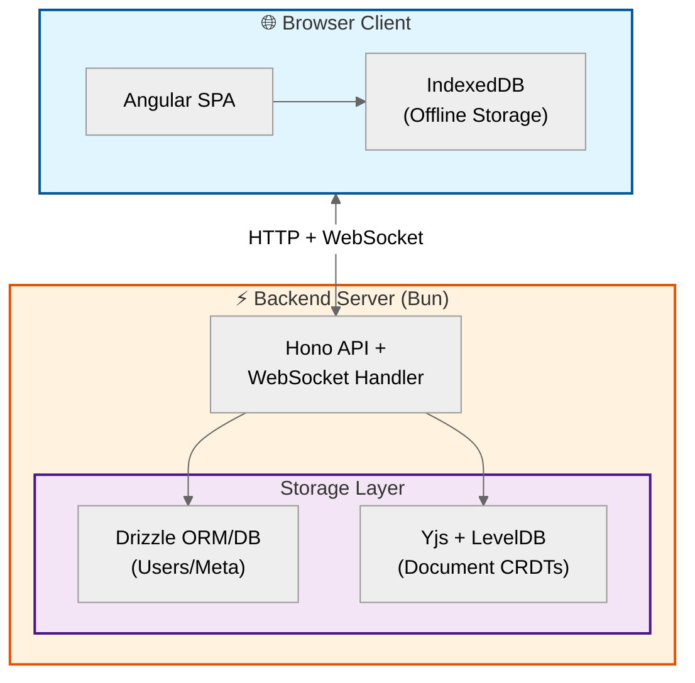
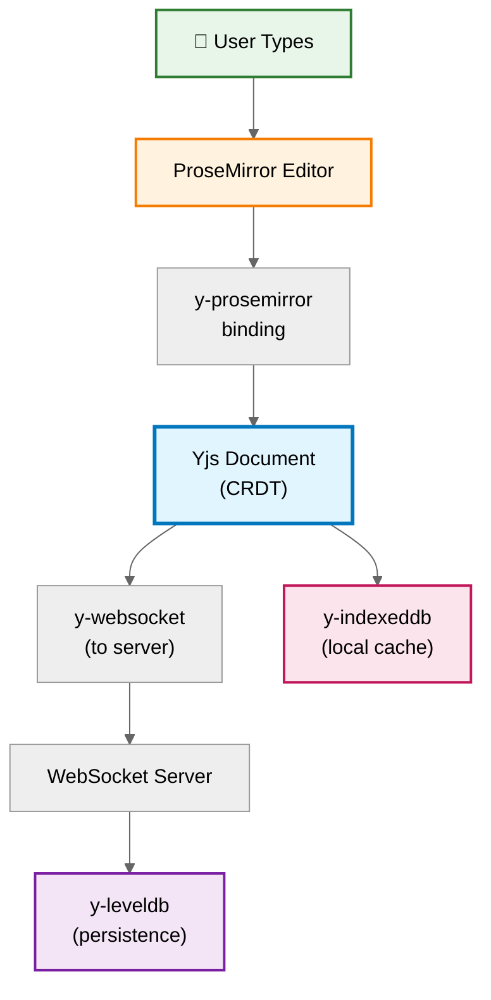
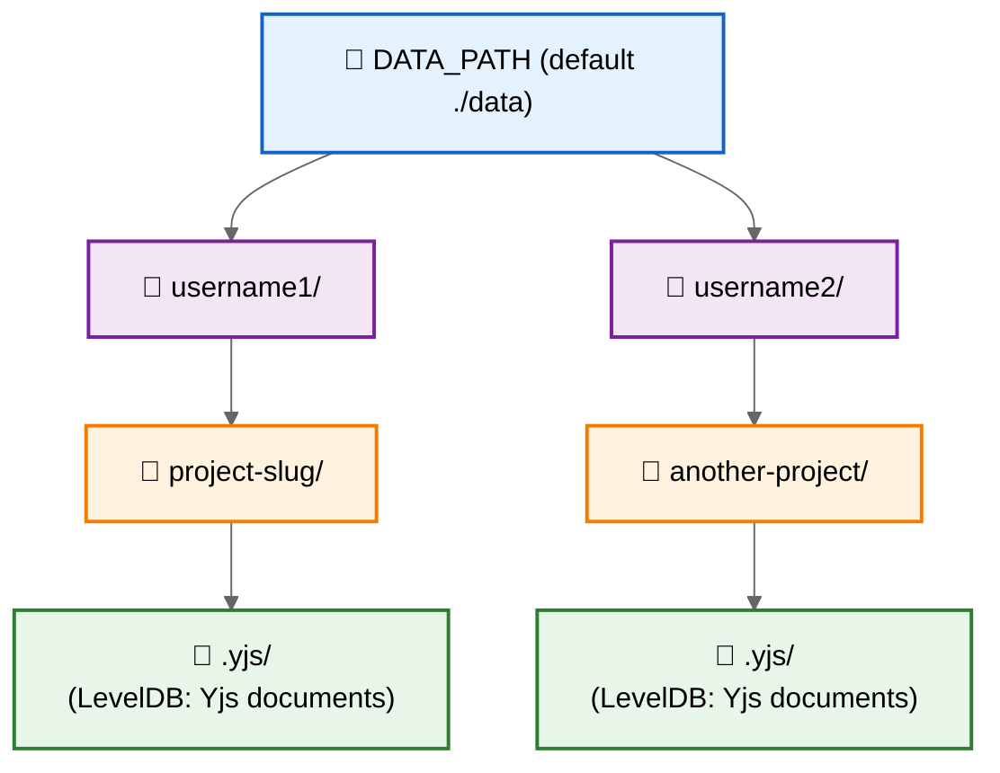
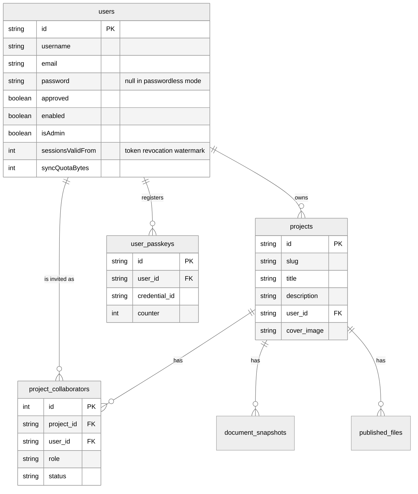
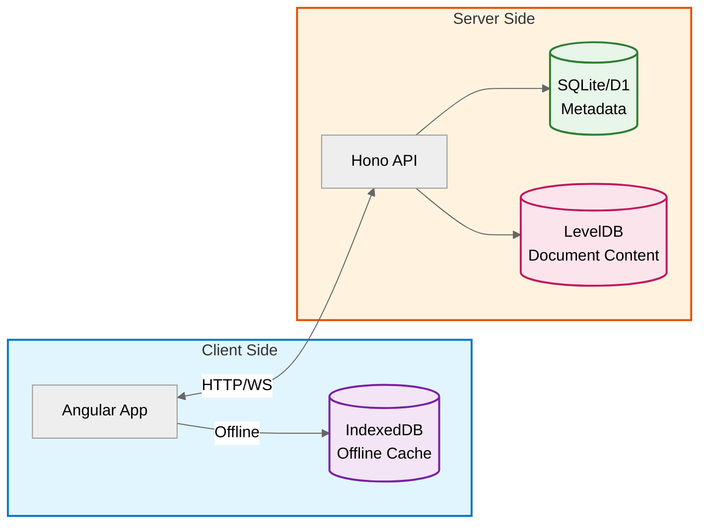
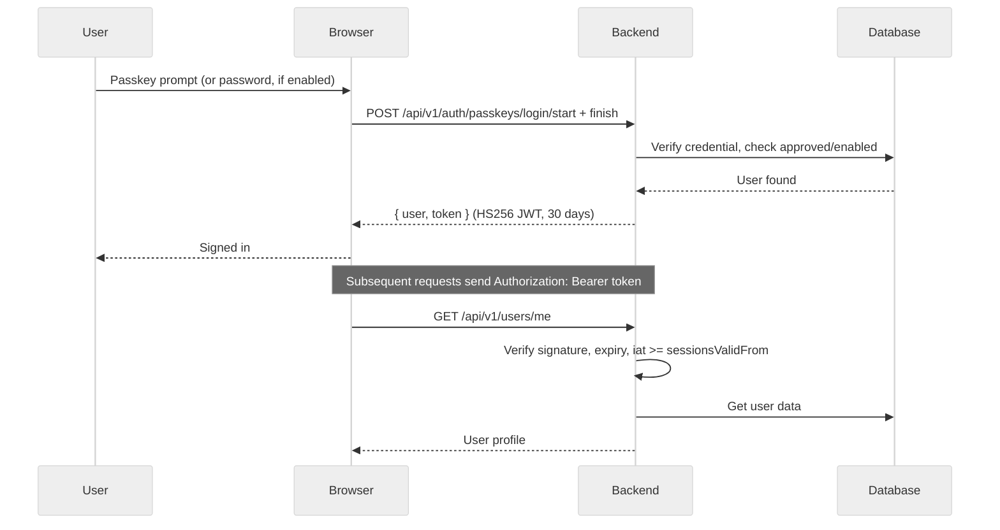
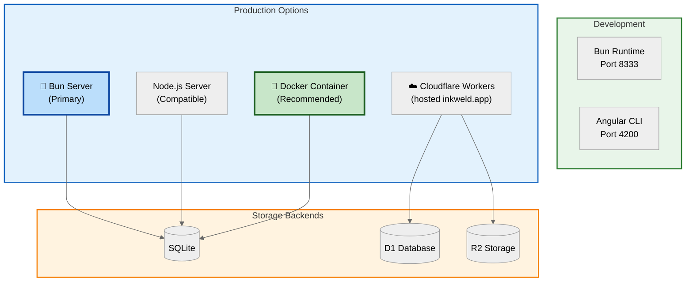
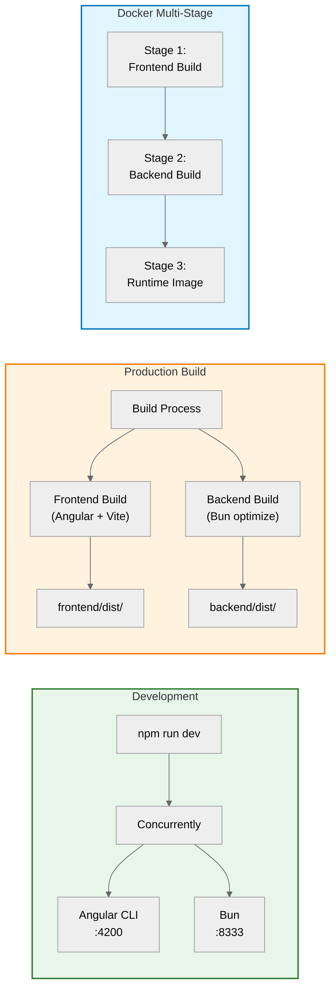
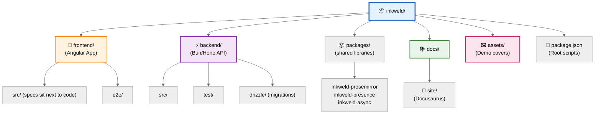

## System Architecture

Inkweld is a monorepo application with distinct frontend and backend services:



## Frontend

### Technology Stack

- **Framework**: Angular with standalone components
- **State Management**: Service-based with RxJS
- **Offline Storage**: IndexedDB via y-indexeddb
- **Real-Time**: Yjs + y-websocket provider
- **Editor**: ProseMirror with y-prosemirror binding
- **Build**: Angular CLI (`@angular/build` application builder, esbuild + Vite dev server)
- **Testing**: Vitest (unit, with `vitest-mock-extended` for mocks) + Playwright (e2e)

### Modern Angular Patterns

```typescript
// Dependency injection with inject()
export class MyComponent {
  private projectService = inject(ProjectService);
  private router = inject(Router);
}

// Modern control flow
@if (project) {
  <app-editor [project]="project" />
} @else {
  <app-loading />
}

@for (item of items; track item.id) {
  <app-item [data]="item" />
}
```

### Key Services

- **ProjectStateService** - Central project state management
- **UnifiedProjectService** - Hybrid online/offline operations
- **DocumentService** - Yjs document lifecycle
- **WorldbuildingService** - Template/schema system
- **UserService** (`services/user/`) - Current user, sign-in state and account actions; passkey, recovery, password-reset and policy-acceptance helpers live in `services/auth/`
- **DocumentSyncPlannerService** (`services/sync/`) - Decides which documents "Sync All" can skip (see [Bulk Sync Fast Path](#bulk-sync-fast-path))

### Editor Schema

The ProseMirror schema is assembled in
`frontend/src/app/components/element-ref/extended-schema.ts`. It composes
three sources:

1. ngx-editor's base nodes and marks (`@bobbyquantum/ngx-editor/schema`)
2. `prosemirror-tables`' `tableNodes()` output
3. Inkweld's own extensions from `@inkweld/prosemirror/schema` — the
   `elementRef` node plus the `comment`, `autoReview`, and secure `link` marks

`new Schema(...)` is constructed **in the frontend**, never inside the shared
package. The shared package returns specs only; building the `Schema` there
would pull a second copy of `prosemirror-model` into the bundle and break the
class-identity checks in y-prosemirror and `EditorView` — typing would
silently stop working. `prosemirror-tables` is pinned in `resolutions`
alongside the other ProseMirror packages for the same reason.

#### Tables

Table support is layered on `prosemirror-tables` rather than on ngx-editor's
menu, because Inkweld replaced that menu with its own Material toolbar
(`editor-toolbar.component.ts`). Only the schema and the editing plugins come
from the library:

- **Schema** — `tableNodes()` with `cellContent: 'paragraph+'`. Cells are
  restricted to paragraphs deliberately: allowing arbitrary blocks would
  permit nested tables and headings that no export format renders sensibly.
  An extra `align` cell attribute carries GFM column alignment.
- **Plugins** — `columnResizing`, `tableEditing`, and a `Tab` / `Shift-Tab`
  keymap, appended to the editor's plugin list in `document.service.ts`.
  `columnResizing` must be registered before `tableEditing`.
- **Wire format** — table node names are block-level in
  `packages/inkweld-prosemirror/src/xml/tags.ts`, so an empty cell serializes
  as `<table_cell></table_cell>` rather than collapsing to a self-closing tag
  and desynchronising the row.
- **Markdown** — `markdownToXml` parses GFM tables and `xmlToMarkdown` emits
  them, so tables round-trip through the MCP tools and markdown export.
- **Publish** — the HTML, EPUB, and Typst/PDF generators each render tables.
  Tables are not yet part of the user-configurable publish-styles system and
  currently get fixed built-in styling.

### Publish output

The publish generators (`frontend/src/app/services/publish/`) read documents,
convert them for a format and never write back to the stored content.

- **Typographic quotes** — a plan option (`typographicQuotes`). Unset, it is
  on for EPUB, PDF, HTML and website output and off for Markdown, whose output
  is source text. `typography.ts` curls straight quotes and apostrophes and
  turns `--` / `---` into dashes, using the quote style and dash convention of
  the plan's language (`metadata.language`; unknown languages use English).
  A paragraph is converted as one run, so a quote after an emphasised word
  still opens correctly, and code blocks and code-marked text are left alone.
- **EPUB cover** — the stored project cover (or the cover chosen on the plan)
  is packaged as the `cover-image`. A project with no stored cover shows a CSS
  placeholder on its home page, which is not a file, so the EPUB generator
  renders that placeholder (artwork, title, author) to a JPEG with
  `DefaultCoverRendererService` and packages it instead.
- **E-book presets** — EPUB is reflowable, so the style editor hides the
  page-setup panel (size, margins, page numbers, running header) for it and
  offers the e-book presets (`medium: 'reflowable'`) alongside the universal
  ones, rather than the print presets. New plans start from the e-book preset.

## Backend (Bun + Hono)

### Technology Stack

- **Runtime**: Bun (JavaScript runtime built for speed)
- **Framework**: Hono (lightweight web framework)
- **Database**: SQLite or D1 via Drizzle ORM
- **Document Storage**: LevelDB (per-project instances)
- **Real-Time**: Yjs over WebSocket (Bun's native WebSocket, or a Durable Object on Workers)
- **Testing**: Bun's built-in test runner (`bun test`)

### API Architecture

Routes are OpenAPI-described Hono routers (`@hono/zod-openapi`) mounted under `/api/v1`, with Zod schemas shared between validation and the generated spec:

```typescript
// Simplified shape of a route in backend/src/routes/
app.use('/projects/*', requireAuth);
app.get('/projects', async (c) => {
  const user = c.get('user');
  const projects = await projectService.findByUser(c.get('db'), user.id);
  return c.json(projects);
});

// Collaboration WebSocket: /api/v1/ws/yjs?documentId=<username>:<slug>:<elementId>
// (the client sends its JWT as the first message; no token in the URL)
```

### Key Modules

- **config/** - Environment parsing and route registration (including rate limits)
- **middleware/** - Auth, CSRF/CORS helpers, per-runtime database injection, error handling, request logging
- **routes/** - HTTP endpoints (one OpenAPI router per area)
- **schemas/** - Zod/OpenAPI request and response schemas
- **services/** - Business logic layer
- **db/** - Drizzle ORM schema and database setup
- **mcp/** - Model Context Protocol server (tools, resources, OAuth-grant permission checks)
- **durable-objects/** - Cloudflare Workers only: the per-project Yjs Durable Object
- **utils/** - Shared helpers (session validity, CSP, project access, WebSocket guards)

Entry points per runtime are `bun-app.ts` / `bun-runner.ts`, `node-app.ts` / `node-runner.ts` and `worker-app.ts`; all call the same `registerCommonRoutes()`.

#### Module map

| Area                                      | Where to look                                                                                                                                                               |
| ----------------------------------------- | --------------------------------------------------------------------------------------------------------------------------------------------------------------------------- |
| Sync capacity (per-user storage quotas)   | `services/quota.service.ts`, `utils/sync-quota.ts`; guide: [Sync Capacity](../admin-guide/sync-capacity.md)                                                                 |
| Legal documents and policy acceptance     | `services/legal.service.ts`, `/config/legal/*` routes                                                                                                                       |
| Account deletion (self-service and admin) | `services/account-deletion.service.ts`                                                                                                                                      |
| Content-Security-Policy                   | `utils/csp.ts` (kept in step with `frontend/public/_headers`)                                                                                                               |
| Custom HTML injection, SPA serving        | `utils/spa-utils.ts`; guide: [Custom HTML](../admin-guide/custom-html.md)                                                                                                   |
| AI image generation providers             | `services/image-providers/` (OpenAI, fal.ai, OpenRouter, Stable Diffusion, Workers AI), `image-generation.service.ts`, `image-profile.service.ts`, `image-audit.service.ts` |
| Linting and auto-review                   | `services/openai-lint.service.ts`, `services/auto-review.service.ts`, `auto-review-rejection.service.ts`                                                                    |
| Passkeys and recovery                     | `services/passkey.service.ts`, `passkey-recovery.service.ts`                                                                                                                |
| Home Assistant ingress                    | `utils/ingress.ts`, `services/ingress-auth.service.ts`                                                                                                                      |
| MCP and its OAuth server                  | `mcp/`, `services/mcp-oauth.service.ts`; guide: [MCP & OAuth](./mcp-oauth.md)                                                                                               |
| Runtime configuration, email, appearance  | `services/config.service.ts`, `email.service.ts`, `appearance.service.ts`                                                                                                   |
| Presence, activity, writing sessions      | `services/presence.service.ts`, `activity.service.ts`, `writing-session.service.ts`                                                                                         |

### Shared Packages

`packages/` holds TypeScript workspaces used by both the frontend and backend (installed from the repo root with `bun install`, tested with `npm run test:packages`):

| Package                                                 | Purpose                                                                       |
| ------------------------------------------------------- | ----------------------------------------------------------------------------- |
| `@inkweld/prosemirror` (`packages/inkweld-prosemirror`) | ProseMirror schema _specs_, Yjs XML serialisation and Markdown/XML conversion |
| `@inkweld/presence` (`packages/inkweld-presence`)       | Binary presence protocol multiplexed onto the elements Yjs WebSocket          |
| `@inkweld/async` (`packages/inkweld-async`)             | Sequential/paginated/bounded-concurrency promise helpers                      |

## Real-Time Collaboration (Yjs)

### CRDT Technology

Yjs uses Conflict-free Replicated Data Types (CRDTs) to enable:

- **Concurrent editing** without conflicts
- **Eventual consistency** across all clients
- **Offline support** with automatic merging
- **Fine-grained updates** (character-level)

### Data Flow



### Per-Project Storage

On Bun/Node each project gets its own LevelDB instance at `<DATA_PATH>/<username>/<slug>/.yjs`, next to the project's media and cover files. On Cloudflare Workers the same role is played by a Durable Object per project with its own SQLite storage:



Benefits:

- **Isolation** - Projects don't interfere
- **Scalability** - Independent read/write operations
- **Cleanup** - Easy to delete project data
- **Idle eviction** - Documents with no connected sockets are dropped from memory after about a minute, and a project's LevelDB handle closes with its last document

### Server Real-Time Layer

Clients connect to `/api/v1/ws/yjs?documentId=<username>:<slug>[:<elementId>]`. The first message is the user's JWT (keeping tokens out of URLs and logs); the server answers `authenticated` or `access-denied:<reason>` and only then starts the Yjs sync protocol. Viewers receive updates but cannot send them. Prose documents each get a connection, while the project's _elements_ document also carries presence (who is online and where) multiplexed by `@inkweld/presence`.

- **Bun / Node** - `services/yjs.service.ts` keeps `WSSharedDoc` instances in memory, persists every update to the project's LevelDB, compacts a document after 50 incremental updates (`LEVELDB_COMPACT_THRESHOLD`), and evicts idle documents. `services/presence.service.ts` holds the in-process presence registry.
- **Cloudflare Workers** - `durable-objects/yjs-project.do.ts` is one Durable Object per `username:slug` that manages all of the project's documents (rather than one object per document, which is far cheaper). It uses WebSocket hibernation, keeps connection state in socket attachments, enforces the auth deadline with an alarm, persists update frames and a compacted snapshot through `yjs-do-storage.ts`, and owns its own presence registry. `durable-objects/ws-rate-limiter.ts` throttles reconnect storms per document, and `utils/ws-guards.ts` holds the guards for its asynchronous auth step.
- **Access** - Access is resolved once when a socket authenticates, so a collaborator removal or role change closes that user's open sockets (`utils/collaborator-revocation.ts`) and the client's reconnect re-runs the access check.

### Bulk Sync Fast Path

"Sync All" on the home screen would otherwise open one WebSocket per prose
document. Instead it first asks the server which documents have changed:

- `GET /api/v1/projects/:username/:slug/docs/sync-manifest` returns an opaque
  `revision` token per document (`document-revision.service.ts`). On Bun it is
  the document's LevelDB update clock; on Workers it is the newest `update:*`
  row key in the project's Durable Object, or, once compaction has removed
  them all, a unique revision marker written with each snapshot. Tokens from
  the two runtimes are not comparable, and a client only compares tokens from
  the same server.
- `DocumentSyncPlannerService` skips a document only when its revision is
  unchanged **and** its local Yjs state digest still matches the checkpoint
  stored in IndexedDB — that is, nothing changed on either side since the last
  sync. The digest (`utils/yjs-state-digest.ts`) encodes a Yjs snapshot (state
  vector plus delete set), because a state vector alone does not change when
  text is only deleted.
- A checkpoint is written only when the revision is identical before and after
  the sync, so a concurrent edit by a collaborator is never recorded as synced.
- `revision: null` means "never persisted, nothing to pull"; `unknown: true`
  means "could not be read, sync it". A missing manifest, an unknown or changed
  revision, a changed digest, or unreadable local state all force a sync.

The planner is deliberately conservative: a bug can only cause an extra sync,
never a missed edit. The priority (currently open) document is always synced.

## Database Schema

### Drizzle ORM Schema

The relational database holds accounts and metadata. **Elements, prose, worldbuilding data and element schemas live in Yjs documents**, not in tables. The tables below are the core ones; others cover OAuth/MCP clients and sessions, comments, snapshots, published files, announcements, activity, image profiles and audits, and runtime config (`backend/src/db/schema/`).



Schema changes ship as Drizzle migrations in `backend/drizzle/` (a single `0000_baseline.sql` plus later migrations generated with `bunx drizzle-kit generate`); they run automatically on startup, and via `wrangler d1 migrations` on Cloudflare.

### Document Storage Architecture



## Authentication & Security



### Tokens, Not Server Sessions

- **JWT bearer tokens** - sign-in returns `{ user, token }`; the client stores the token (`AuthTokenService`) and sends `Authorization: Bearer <token>`. Tokens are HS256-signed with `DATABASE_KEY` / `SESSION_SECRET` and last 30 days. WebSockets authenticate with the same token as their first message.
- **Revocation** - because tokens are stateless, each user has a `sessionsValidFrom` watermark. It is bumped by password reset, passkey recovery, and admin disable/unapprove; any token issued before it is rejected (`utils/session-validity.ts`, also enforced by the Durable Object).
- **Enrolment tokens** - a newly registered user awaiting approval gets a 15-minute token that can only enrol a passkey.
- **MCP** uses separate OAuth 2.1 access tokens scoped to per-project grants; see [MCP & OAuth](./mcp-oauth.md).
- **Optional GitHub OAuth** sign-in.

### Passwordless-First

- **Passkeys (WebAuthn)** are the default sign-in. `PASSWORD_LOGIN_ENABLED` defaults to `false`: `/auth/login` and the password-reset endpoints are disabled, and registration enrols a passkey immediately (via `@simplewebauthn/server`; challenges are single-use and expire after 5 minutes).
- **Email recovery** (`EMAIL_RECOVERY_ENABLED`, needs SMTP) - in passwordless mode a magic link lets a user enrol a _new_ passkey from a verified email; existing passkeys are kept. In password mode it powers the classic forgot-password flow.
- **User approval workflow** (optional) gates new accounts.
- **Home Assistant ingress** - when run as a Home Assistant app, requests from the Supervisor proxy are trusted by TCP peer address (never by header alone) and the HA user is linked to an Inkweld account by `POST /api/v1/auth/ingress`. A session is only valid for the HA user making the request.

### Security Measures

- **CORS** configuration via `ALLOWED_ORIGINS`, which is also the expected origin set for passkeys
- **CSRF protection** (origin checks) on state-changing requests
- **Content Security Policy** on the served `index.html`; scripts are allowed by hash/origin, so the built page contains no inline script (`utils/csp.ts`)
- **Rate limiting** on auth, passkey, recovery and OAuth client-registration endpoints. The limits are fixed (not configurable), per client IP and held in process memory, so on Workers use Cloudflare WAF rules instead. See [API](./api.md#rate-limiting)
- **Storage quotas** (optional) refuse new uploads, never edits, once an account is over its allowance

## Deployment Targets



### Bun (Primary)

```bash
cd backend
bun run dev          # Development
bun run build        # Production build into dist/
bun run start        # Production server (NODE_ENV=production)
```

### Node.js (Compatible)

```bash
cd backend
bun run build:node   # Transpile for Node
bun run start:node   # node dist/node-runner.js
```

### Cloudflare Workers

The hosted preview and production sites run here, deployed by CI (see [CI/CD](../admin-guide/ci-cd.md)). To deploy your own, use `bun run cloudflare:setup` and the `cloudflare:*` scripts described in [Getting Started](../getting-started.md#cloudflare-worker--durable-objects). `bun run build:worker` only validates the bundle (`wrangler deploy --dry-run`).

Requires:

- Durable Objects (`YJS_PROJECTS`) for WebSocket persistence
- A D1 database binding
- An R2 bucket (`STORAGE`) for media and other files

### Docker (Recommended for Production)

```bash
docker build -t inkweld .
docker run -p 8333:8333 -v inkweld_data:/data \
  -e SESSION_SECRET=$(openssl rand -hex 32) \
  -e WEBAUTHN_RP_ID=localhost \
  -e ALLOWED_ORIGINS=http://localhost:8333 \
  inkweld
```

Benefits:

- Single self-contained image with the frontend embedded
- Automatic migrations on startup
- Volume mounting for persistence
- Health check endpoint

## Build Pipeline



### Development

```bash
npm run dev  # Runs both frontend and backend
```

Powered by:

- **Concurrently** to run multiple processes
- **Angular CLI** dev server (port 4200)
- **Bun** runtime (port 8333)

### Production

```bash
# Frontend
cd frontend
bun run build
bun run compress-wasm  # Optional: Brotli-compress .wasm files

# Backend
cd backend
bun run build
```

Output:

- **frontend/dist/** - Angular production bundle
- **backend/dist/** - Bun-optimized backend code (the Docker image instead compiles a single `inkweld-server` binary with `bun build --compile`)

### Docker Build

Multi-stage Dockerfile:

1. **Frontend build** stage (Bun image with a Node binary for `ng build`; skipped when CI supplies a pre-built frontend)
2. **Backend build** stage (Bun) - embeds the frontend assets and compiles a standalone `./inkweld-server` binary with its native modules
3. **Runtime** stage (`debian:bookworm-slim`)
   - Runs `./inkweld-server`, not a Bun install
   - Copies the frontend dist and Drizzle migrations for auto-run
   - Non-root `inkweld` user and a health check on `/api/v1/health`

## Testing Strategy

### Frontend Tests

```bash
npm test          # Vitest unit tests
npm run e2e       # Playwright e2e tests
```

- **Unit tests** with Vitest and `vitest-mock-extended` (`*.spec.ts` next to the code)
- **E2E tests** in four groups: `e2e/local` (offline, no backend), `e2e/online` (real Bun backend), `e2e/mcp` and `e2e/screenshots`; each has its own `fixtures.ts`. A Wrangler-runtime variant of the online suite runs in CI
- **Mock API** handlers in `e2e/mock-api/`
- **Screenshot tests** generate the documentation images

### Backend Tests

```bash
bun test
```

- **Unit tests** for services and utilities (`*.spec.ts` in `src/`, plus `backend/test/`)
- **Integration tests** call the Hono app directly (`app.request(...)`), with no HTTP server or Supertest
- **In-memory SQLite** for test isolation
- Rate limiting is disabled under `NODE_ENV=test`

## API Documentation

### OpenAPI Specification

Generated from code annotations:

```bash
cd backend
bun run generate:openapi
```

Output: `backend/openapi.json`

### Client Generation

Auto-generate TypeScript client for frontend:

```bash
cd backend
bun run generate:angular-client
```

Output: `frontend/src/api-client/`

**Never edit generated files manually.**

## Code Quality

### Linting

- **ESLint** with TypeScript support (lint rules only; it does not check formatting)
- **`bun fmt`** for formatting, with the Prettier config in each package. `bun run format` writes, `bun run format:check` (run by verify and CI) only reports
- **`npm run typecheck`** (`bun check`) type checks every project, including specs and e2e tests

### Git Hooks

[Husky](https://typicode.github.io/husky/) hooks live in `.husky/` and are installed by `bun install` (the `prepare` script):

- **pre-commit** runs `lint-staged` (`bun fmt` on staged frontend, backend and docs files, plus ESLint `--fix` on backend sources) and blocks an accidental `backend/package-lock.json`
- **pre-push** refuses direct pushes to `main` and checks commit messages with commitlint (conventional commits)

### CI/CD

GitHub Actions workflow:

1. **Lint** all code
2. **Test** frontend and backend
3. **Build** Docker image
4. **Publish** to GHCR (on main branch)
5. **Deploy** to Cloudflare: preview from `main`, production (inkweld.app)
   from the `production` branch — see [CI/CD](../admin-guide/ci-cd.md)

## Performance Considerations

### Frontend

- **Lazy loading** for routes
- **OnPush change detection** where appropriate
- **Service Worker** for offline support

### Backend

- **LevelDB handles and in-memory documents** are opened on demand and evicted when idle
- **Database indexing** on foreign keys
- **Pagination** for large result sets
- **Per-document WebSocket reconnect throttling** to protect against reconnect storms

### Real-Time

- **Debounced updates** for UI refresh
- **Incremental sync** (only changed content)
- **Efficient CRDT** merging via Yjs
- **Binary encoding** over WebSocket

## Development Workflow

### Workspace Structure



### NPM Scripts (Root)

```bash
bun install          # Install all dependencies
npm run dev          # Start dev servers
npm test             # Run all tests
npm run lint         # Lint all code
npm run typecheck    # Type check every project (bun check)
```

`backend/data/` (or whatever `DATA_PATH` points at) is created at runtime and holds the SQLite file and per-project data; it is not part of the source tree.

### Git Workflow

1. Create feature branch
2. Make changes + add tests
3. Run `npm test`, `npm run lint` and `npm run typecheck`
4. Open PR
5. CI validates
6. Merge to main

## Extensibility

### Custom Worldbuilding Templates

Worldbuilding element schemas (templates) are edited in-app through the unified
interactive schema editor: the `WorldbuildingEditorComponent` renders a live
preview of the schema (`previewSchema` + `editMode` inputs) and the owning
`TemplateEditorPageComponent` applies the resulting `SchemaEditEvent`s to its
own schema state, autosaving via the `schemaChange` output.

The editor has two responsive layouts — a sidenav with sections on wide screens
and a stacked accordion on narrow ones. In edit mode **Schema Details** is the
top tab/section (name, icon, description), followed by the schema's tabs and the
fixed Identity, Relationships, Media and Styling sections. Within the preview
you can:

- add/remove/reorder tabs and fields,
- edit each field's config inline (label, type, placeholder, options, …),
- rename a tab and pick its icon from a curated Material-icon picker that covers
  every built-in element-type icon (so existing schemas' icons are always
  available),
- edit the schema name/icon/description under Schema Details,
- set the default appearance/image that new elements of this type get under
  Styling.

Changes save automatically; schema-design snapshots can be created and restored
from the snapshot button.

```typescript
interface ElementTypeSchema {
  id: string; // nanoid, used for all lookups
  name: string;
  icon: string; // Material icon name
  description: string;
  version: number; // bumped on each save, used for migrations
  tabs: TabSchema[];
  defaultValues?: Record<string, unknown>;
  defaultAppearance?: ElementAppearance; // menu/content backgrounds
  defaultImage?: string; // media:// reference or URL
}

interface TabSchema {
  key: string;
  label: string;
  icon?: string;
  order?: number;
  fields: FieldSchema[];
}

interface FieldSchema {
  key: string;
  label: string;
  type:
    | 'text'
    | 'textarea'
    | 'number'
    | 'date'
    | 'select'
    | 'multiselect'
    | 'array'
    | 'checkbox';
  placeholder?: string;
  description?: string;
  defaultValue?: unknown;
  options?: string[] | { value: string; label: string }[];
  validation?: FieldValidation;
  layout?: { span?: number; order?: number };
}
```

### Plugin System (Future)

Consider:

- Custom document types
- Export format plugins
- Theme customization
- Integration hooks (Discord, Slack)

## Next Steps

- Review [API documentation](/api)
- Read [deployment guide](../installation/docker)
- Check the [user guide](/user-guide/)
- Explore the [features](/features)
